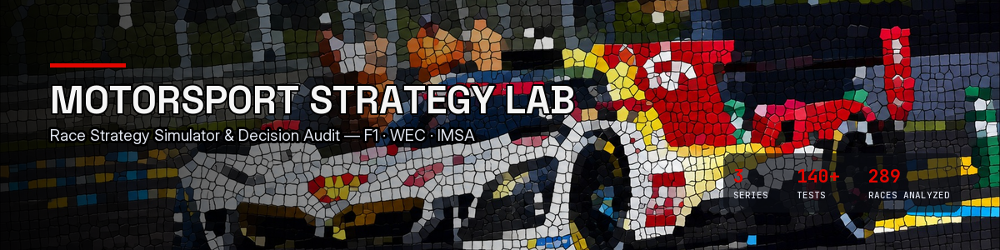
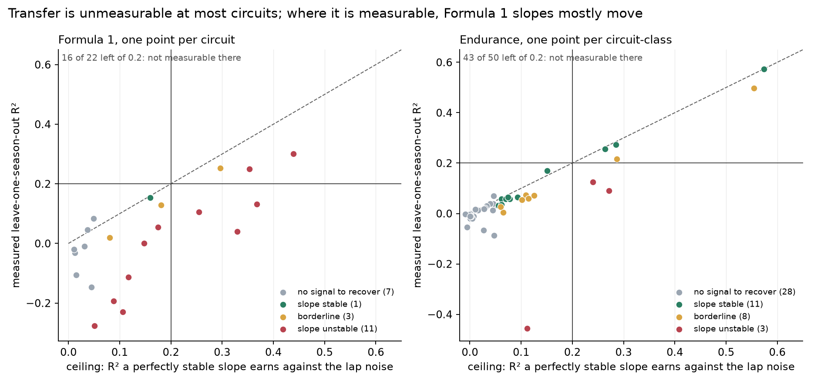
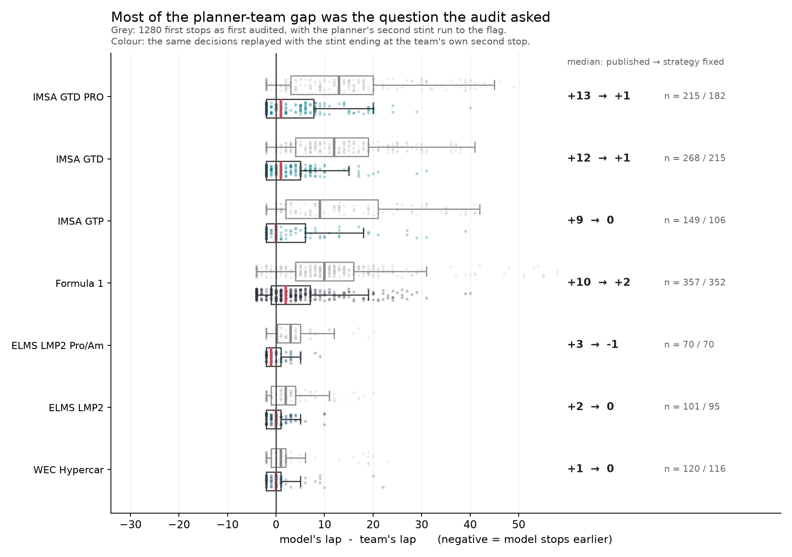

# Motorsport Strategy Lab

**Race strategy across four championships** — by Mohammed Reda Medjadj

<p align="center">
  
</p>

<p align="center">
  <a href="https://doi.org/10.5281/zenodo.22726130"></a>
  <a href="https://github.com/mohammedmedjadj/Motorsport-Strategy-Lab/actions/workflows/tests.yml"></a>
  <a href="LICENSE"></a>
  
  
  
</p>

<p align="center">
  <a href="https://mohammedmedjadj.github.io/Motorsport-Strategy-Lab/">Website</a> ·
  <a href="https://motorsport-strategy-lab.streamlit.app/">Live demo</a> ·
  <a href="paper/main.tex">Paper</a> ·
  <a href="docs/full-readme.md">Full documentation</a> ·
  <a href="reports/">98 reports</a> ·
  <a href="outreach/">Open questions</a> ·
  <a href="https://doi.org/10.5281/zenodo.22726130">DOI</a>
</p>

Fitted tyre degradation, Bayesian neutralisation risk, measured pit loss and
track position, an exact multi-stop dynamic program and a Monte Carlo engine —
applied to Formula 1, WEC, IMSA and ELMS under one protocol, across seven car
classes. Then 1,280 real pit-stop decisions replayed against all of it, three
rule-of-thumb baselines scored on the same decisions, and confidence intervals
on every headline.

Transfer is mostly not measurable from public timing, because inside a stint
fuel burn nearly cancels tyre wear; measured directly, slopes move between
races anyway. Held to each team's own next stop, a planner stops within a few
laps of the real pit wall — but so does a rule that uses no fitted quantity, so
the agreement comes from the horizon. What the stops do reveal is the compound
difference the fitted slopes miss.

---

## Three results

<table>
<tr>
<td width="33%"></td>
<td width="33%"></td>
<td width="33%" valign="middle" align="center"><i>implied wear ratio:<br>0.73 to a harder compound<br>1.74 to a softer one<br>fitted: 1.02 and 0.87</i></td>
</tr>
<tr>
<td valign="top"><b>Transfer is mostly not measurable, and slopes move.</b> Only 5 of 51 endurance circuit-classes and 3 of 22 F1 circuits clear a within-stint R² of 0.2 (best: GT3 at Lime Rock, <b>+0.573</b>). The reason is physical: in F1 the median fuel term is −0.053 s/lap against +0.040 for wear, so the net slope a stint shows is 0.030 s/lap against 0.67 s of lap noise. Rebuilt with a slope stable by construction, 16 of 22 F1 circuits and 43 of 50 endurance circuit-classes still could not clear 0.2. Measured directly as a variance component, the slope moves between races at 31 of 45 F1 circuit-compounds (median I² 0.84 [0.66, 0.91]; between-race SD a median 31% [16, 60] of the slope) and at 42 of 51 endurance circuit-classes. Track temperature explains 2% of it. Recoding to the real Pirelli compound (C1–C6), Friday long runs, a temperature term, past-only fitting and a category-wide slope do not establish any gain. The raw GT3-over-prototype difference (+0.164) falls to +0.035 [−0.005, +0.085], p = 0.22, paired within the 9 events that run both: a difference between circuits, not car types.</td>

<td valign="top"><b>With the strategy held fixed, the planner agrees with teams — and the agreement comes from the horizon.</b> 1,280 replayed first stops. Run to the flag, the planner is +10 laps late in F1 [+8, +11.5], because it answers a different question from a team that already planned a second stop. Holding each team's next stop fixed: <b>+2</b> [+1, +4] over 352 F1 decisions, <b>+3</b> [+2, +4] out of sample with slopes fitted without the decision's season, +1 to +3 across lookbacks and fields. But a ratio-one rule — balance tyre age before the team's next stop, no fitted quantity — ties the full engine's error in 7 of 7 classes. A <a href="paper/prospective_protocol.md">prospective test</a> was frozen before the 2026 São Paulo Grand Prix.</td>
<td valign="top"><b>The stops carry the compound difference the fit misses.</b> Inverting the time-optimal stop at the lap each team chose gives the wear ratio that would make it optimal: the tyre's age at the stop over the length of the next stint, with no fitted slope in it. Pooled it is 0.77 [0.70, 0.83] against a fitted 1.02. Split by the direction of the change it is <b>0.73</b> [0.68, 0.77] to a harder compound (204 decisions) and <b>1.74</b> [1.43, 2.53] to a softer one (28), on the side of one hardness predicts for 79% of decisions against 48% for the fitted slopes: teams act on a compound difference public timing does not resolve. A stop hazard on every lap at risk agrees in sign (0.50 [0.34, 0.77], slopes refitted in every replicate) but cannot separate the directions. Replayed on the 11 already-ingested 2026 races with the frozen models (out of sample, not pre-registered): committed median +1 [−4, +4] over 54 decisions.</td>
</tr>
</table>

**Run to the flag, a rule of thumb sits closer to real practice in 5 of the 7 classes; given the team's next stop, a rule with no fitted quantity ties the optimiser everywhere.**

| class | optimiser | B1 interval | B2 threshold | B3 fuel | optimiser, next stop fixed | ratio one, next stop fixed |
|---|---|---|---|---|---|---|
| Formula 1 | 10 | 11 | **7** | — | 4 | 4 |
| IMSA GTP | 9 | 9 | 54 | 14 | 2 | 2 |
| IMSA GTD | 12 | **7** | 18 | 14 | 2 | 2 |
| IMSA GTD PRO | 12 | **9** | 33 | 15 | 2 | 2 |
| WEC Hypercar | 2 | 2 | 39 | **1** | 1 | 1 |
| ELMS LMP2 | **2** | 3 | 45 | 4 | 2 | 2 |
| ELMS LMP2 Pro/Am | 3 | **2** | 45 | 4 | 2 | 2 |

Median absolute lap error against the real stop. The first four columns are run
to the flag, on 1,263 of the audit's 1,280 decisions; bold marks the best of
them. B1 uses no fitted quantity at all, only the race length and the number of
stops the tank forces. The last two columns are given the team's own next stop.

Closer to what teams did is not the same as better. Everything here scores
agreement with practice, never which plan was faster.

## Quick start

Everything except two Kaggle-fed layers runs offline from the clone. No API key,
no account, no download.

```bash
git clone https://github.com/mohammedmedjadj/Motorsport-Strategy-Lab.git
cd Motorsport-Strategy-Lab && pip install -r requirements.txt
python scripts/run_baseline_comparison.py
```

That replays 1,263 real decisions and prints the table above. About a minute.

```bash
python scripts/run_formal_tests.py       # intervals on every headline result
python scripts/make_headline_figures.py  # the three figures above
streamlit run demo/app.py                # after pip install -r demo/requirements.txt
```

Or open the deployed one: **<https://motorsport-strategy-lab.streamlit.app/>**. Seven panels, one per modelled class,
running the same simulator and the same fitted models the reports use.
Deployment notes: [`deploy/streamlit/`](deploy/streamlit/README.md).

## What underwrites it

No fabricated data anywhere. Every quantity is measured from published timing or
absent, and where a source lacks something that is a stated limitation rather
than a patched gap. Standard errors are cluster-robust throughout, on the
driver-race, referred to t(G−1).

Two estimators were built for this work, validated on synthetic races, and then
withdrawn when they failed on real fields. Both withdrawals are written up.

Every artifact derived from committed data is regenerated in CI, which fails on
any difference between the working tree and the repository — including files a
generator wrote that were never committed, a blind spot that once allowed three
weeks of silent drift. The paper contains no numbers of its own: every quantity
is a macro generated from the artifacts, so the manuscript cannot drift from the
data.

531 tests, including one file whose only job is to recompute each published
headline and assert the result appears in the document publishing it.

## Where the evidence is thin

The Limitations section, and it is generated rather than written: a script
walks the artifact behind each headline claim and counts what sits under it.
Published numbers do not all rest on the same weight of evidence and a results
table cannot show which is which, so this is what lets a reader weigh them one
at a time. Full report in
[`reports/cross_series/thin_evidence.md`](reports/cross_series/thin_evidence.md).

The 22.5 s cheap-stop threshold is a maximum set by a single race; drop that race
and it moves to 13.2 s. Lime Rock GTD PRO's +0.497 transfer score is the mean of
two folds that run from +0.357 to +0.638. The 14-fold track-position range has
three races behind its high end, at a circuit first run in 2023. And the
audit's original run-to-flag gap was not a fair comparison: the model was offered
every remaining lap while a pit wall chooses inside a plan it has already
committed to. The committed replay is the fix, and once it is applied a rule with
no fitted quantity agrees with teams as well as the model does.

## Where it sits in the literature

There is a real body of work here, from Bekker and Lotz in 2009 through
Heilmeier's group at TUM, dynamic-programming treatments by Carrasco Heine and
Thraves, a Stackelberg formulation by Aguad and Thraves, and a recent wave of
learning-based approaches. Seventeen papers, verified against their publication
records, are catalogued in
[`reports/cross_series/related_work.md`](reports/cross_series/related_work.md).
One of them is an unreviewed preprint and the table says so in its row.

The modelling here is simpler than most of them. What that literature does not
do is validate: almost nobody tests whether the fitted parameters predict a
season they were not fitted to, and nobody confronts the optimiser with what
teams actually did at scale. The contribution is the validation, not the
machinery.

## Repository

```
src/          degradation, safety_car, simulator, audit, stats, weather, reporting
scripts/      one per pipeline stage; run_*.py write artifacts, make_*.py write figures
data/derived/ every committed artifact, one directory per series
reports/      94 documents, one branch per class, plus figures/ and cross_series/
paper/        main.tex (no digits) + numbers.tex (generated)
docs/         the website, and the long README
outreach/     one-pager, three methodological questions, a ready-to-file FastF1 issue
demo/         Streamlit app over the real simulators, driven headlessly by tests
```

Detail on any of it: [`docs/full-readme.md`](docs/full-readme.md).

## Data and licence

Formula 1 timing from [FastF1](https://github.com/theOehrly/Fast-F1). Endurance
timing from [`tobil/imsa`](https://huggingface.co/datasets/tobil/imsa), MIT,
curated by the IMSA Data Scraper Project from IMSA WeatherTech official
results. Weather from Open-Meteo. Two further layers read a
Kaggle export this repository does not redistribute and whose licence is not
yet recorded, described in
[`data/external/README.md`](data/external/README.md).

Released under CC BY-NC-SA 4.0, which covers this project's own code, models
and derived output. It does not reach the upstream sources, and the
non-commercial term in particular cannot be imposed on MIT-licensed material —
see [`THIRD_PARTY_NOTICES.md`](THIRD_PARTY_NOTICES.md).

Archived on Zenodo, and through it in Software Heritage and OpenAIRE. Two DOIs,
and they are not interchangeable. Cite
[`10.5281/zenodo.22726130`](https://doi.org/10.5281/zenodo.22726130) to point at the project — it resolves
to whatever the newest version is. Cite
[`10.5281/zenodo.23845526`](https://doi.org/10.5281/zenodo.23845526) when you need the exact state a result
came from: that one is frozen at v1.2.0 and will not move under you.

GitHub's *Cite this repository* button reads [`CITATION.cff`](CITATION.cff) and
produces the v1.2.0 citation.
